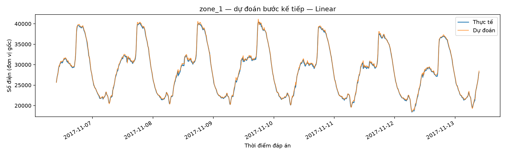

# Kết quả theo từng bước — dự đoán sau 10 phút

DS66B, nhóm 14. Cập nhật 27/10/2026, từ lần chạy thật đã kiểm tra.

Hai notebook có cùng phép tính/kết quả; bản giải thích thêm comment từng dòng. 27 ô code, 42 hàng kết quả đối chiếu; chạy trên máy mất 1295.0 giây. Colab có thể khác.

## 1. Tổng quan

52.416 dòng, 364 ngày, 01/01–30/12/2017, cách nhau 10 phút; ba khu vực và năm số đo thời tiết/bức xạ.
Chia ngay sau đọc theo thời gian: train 36.691, validation 7.862, test 7.863 dòng gốc. Hai ô hiện dữ liệu thô rồi dữ liệu đổi tên/định dạng giờ. Biểu đồ train dùng trung bình ngày; dữ liệu học vẫn 10 phút.
Để so công bằng khi thêm lịch sử tháng, mọi cấu hình dùng cùng mốc đủ lịch sử: train 32,227, validation 7,861, test 7,862. Có chừa một dòng ở ranh giới đáp án train.

## 2. Bắt đầu đơn giản rồi thêm đầu vào

Persistence đoán bằng mức hiện tại. Các mô hình ban đầu chỉ dùng 8 số đo hiện tại. Sau đó thêm lịch sử/giờ thành 40 biến; thử tuần/tháng và chốt nhóm bằng validation.

| Phương án | Số biến | Validation MAE | Test MAE | Test RMSE | Test MAPE (%) | Test R2 |
| --- | --- | --- | --- | --- | --- | --- |
| Persistence | 3.0000 | 295.4928 | 293.1130 | 456.7377 | 1.4608 | 0.9915 |
| Linear (8 biến) | 8.0000 | 313.1016 | 301.5586 | 453.2010 | 1.4963 | 0.9918 |
| Linear (40 biến) | 40.0000 | 166.4142 | 178.6915 | 278.4380 | 0.9275 | 0.9965 |
| Linear | 49.0000 | 163.7002 | 173.5309 | 271.3365 | 0.8951 | 0.9967 |
| Ridge (tuned) | 49.0000 | 163.7004 | 173.5318 | 271.3373 | 0.8951 | 0.9967 |
| Lasso (tuned) | 49.0000 | 183.3297 | 196.1033 | 299.8879 | 1.0700 | 0.9953 |
| Random Forest (tuned) | 49.0000 | 910.6617 | 1,878.9355 | 2,739.3874 | 10.4515 | 0.6910 |
| Random Forest (delta) | 49.0000 | 196.3589 | 252.4308 | 384.1976 | 1.2816 | 0.9939 |
| MLP (tuned) | 49.0000 | 413.6242 | 865.7364 | 1,073.5361 | 5.5248 | 0.9343 |
| MLP (delta) | 49.0000 | 172.0831 | 219.1560 | 324.3047 | 1.0917 | 0.9954 |

Các hàng RF/MLP là các nhánh thử nghiệm, không phải mỗi hàng đều tốt hơn hàng ngay trước nó. Ridge/Lasso tìm tham số riêng, không phải tối ưu trực tiếp mô hình Linear.

### Cùng tham số, trước và sau đổi đầu vào

| Phương án | MAE test — 8 biến | MAE test — nhóm đã chọn |
| --- | --- | --- |
| Linear | 301.5586 | 173.5309 |
| Ridge | 357.4468 | 255.5105 |
| Lasso | 301.2296 | 277.6832 |
| KNN | 2,869.1284 | 3,213.8866 |
| Decision Tree | 2,224.0141 | 2,176.6558 |
| Random Forest | 1,919.6764 | 1,956.8568 |
| PCA + Ridge | 4,131.2015 | 1,111.9870 |
| MLP | 754.6490 | 536.4603 |

### Chu kỳ tuần và tháng

| Phương án | Số biến | Validation MAE | Test MAE |
| --- | --- | --- | --- |
| Linear - Ngắn hạn | 40.0000 | 166.4142 | 178.6915 |
| Linear - + Tuần | 49.0000 | 163.7002 | 173.5309 |
| Linear - + Tháng | 47.0000 | 168.1104 | 181.8413 |
| Linear - + Tuần và tháng | 56.0000 | 165.4323 | 176.7311 |

Chọn nhóm + Tuần bằng validation, không đổi theo test. Sin/cos giúp diễn tả tính vòng tròn của giờ/thứ; chưa thử riêng bỏ/giữ sin/cos nên không quy toàn bộ cải thiện cho riêng nó.

## 3. Tìm tham số và thử thêm

GridSearchCV dùng ba lượt chia theo thời gian trong train, gap=1. Scaler/PCA/chuẩn hóa đáp án MLP nằm bên trong từng lượt CV. Sau mỗi nhóm tìm tham số có bảng validation/test trước và sau.
Học delta: dự đoán mức tăng/giảm rồi cộng lại mức hiện tại; thử RF/MLP với tham số giữ nguyên từ bài mức điện. Chưa tìm tham số riêng cho delta.
Thử tám cách giữ/bỏ nhóm biến với Linear. Chưa có cách giảm biến tốt hơn đồng thời CV và validation; giữ nhóm đã chọn. Không chọn cách bỏ biến theo test.

Các bảng từng bước nằm trong optimization_progression.csv; một số mốc được nhắc lại để so công bằng, không phải tất cả các hàng đều là cấu hình khác nhau; tất cả 42 hàng nằm trong all_experiment_results.csv. train_test_model_comparison.csv giữ bốn metric train/test của các phương án đủ điều kiện chọn. test_mae_by_zone.csv tách sai số từng khu vực.

## 4. Chốt bằng validation

Phương án chọn: Linear, nhóm đầu vào + Tuần (49 biến). So với mốc đơn giản theo từng khu vực:

| Phương án | zone_1 | zone_2 | zone_3 |
| --- | --- | --- | --- |
| Persistence | 364.3591 | 312.3959 | 202.5840 |
| Linear | 220.1709 | 161.9985 | 138.4233 |

MAE/RMSE/MAPE chung ba khu vực; R² trung bình từng khu vực, không phải tỷ lệ chính xác. MAE có đơn vị gốc. Bảng tuần/tháng theo thời điểm đáp án; biểu đồ dưới chỉ hiện 7 ngày đầu test ở zone_1, không phải toàn bộ thời gian test.

## 5. Giới hạn

Tất cả lựa chọn dùng train/CV/validation. Test được đối chiếu sau từng bước theo yêu cầu nhóm; đây là test đã dùng từ các phiên trước, không phải tập kiểm chứng mới. Không dùng điểm test để định hướng các lượt thử tiếp. Muốn kiểm chứng độc lập cần dữ liệu tương lai mới.
Tại mỗi mốc test được dùng số đo đã biết tới hiện tại, không dùng đáp án tương lai và không fit lại mô hình/scaler/PCA trên test. Dữ liệu chỉ có Tetouan năm 2017.
Chưa thử cây riêng từng khu vực. Linear đã có hệ số riêng cho mỗi đáp án; tách ba lần fit cùng X không phải tối ưu mới.
Mã/giải thích tiếng Việt để học hiểu; slide và report nộp cuối vẫn cần theo template và ngôn ngữ môn học.

Nguồn: [UCI Tetouan](https://archive.ics.uci.edu/dataset/849/power+consumption+of+tetouan+city). Nội dung lớp: MLP chương 11, metrics chương 13, PCA chương 14.
